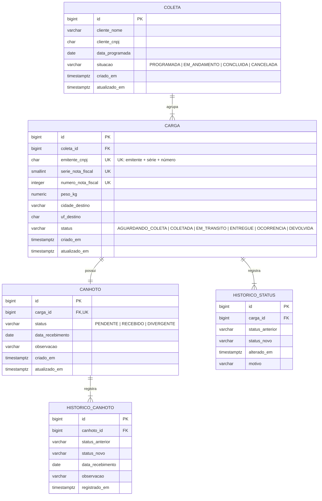

# API Controle de Canhotos

API REST para controle de coletas, cargas e devolução de canhotos (comprovantes de entrega assinados) em uma transportadora, com histórico de status por carga.

> Projeto em construção.

## Modelo de domínio



- Cada carga corresponde a **uma NF**, identificada por CNPJ do emitente + série + número (combinação única por lei).
- Se não informados, o CNPJ do emitente assume o do cliente da coleta e a série assume `1`.
- O canhoto nasce `PENDENTE` junto com a carga. `RECEBIDO` e `DIVERGENTE` exigem data de recebimento; `DIVERGENTE` exige observação.
- O canhoto só pode ser registrado (`RECEBIDO` ou `DIVERGENTE`) com a carga `ENTREGUE`.
- Data de recebimento posterior à data atual (no fuso `America/Sao_Paulo`, independente do fuso do servidor) gera aviso e só é aceita com confirmação explícita.
- O canhoto pode ser registrado mais de uma vez (ex.: `DIVERGENTE` e depois `RECEBIDO`). Cada registro fica em `historico_canhoto` com status, data e observação; o canhoto guarda só o estado atual.
- Toda mudança de status da carga gera um registro em `historico_status`.
- Evolução prevista: agrupar NFs por CT-e (uma carga com várias NFs).

### Transições de status da carga

| De | Pode ir para |
|---|---|
| `AGUARDANDO_COLETA` | `COLETADA`, `OCORRENCIA` |
| `COLETADA` | `EM_TRANSITO`, `OCORRENCIA` |
| `EM_TRANSITO` | `ENTREGUE`, `OCORRENCIA`, `DEVOLVIDA` |
| `OCORRENCIA` | `AGUARDANDO_COLETA`, `COLETADA`, `EM_TRANSITO`, `ENTREGUE`, `DEVOLVIDA` |
| `ENTREGUE` | `OCORRENCIA` (retrocesso sempre passa por ocorrência) |
| `DEVOLVIDA` | — (final) |

Registrar `OCORRENCIA` exige motivo.

## Stack

Java 21 · Spring Boot 4.1 · Spring Data JPA (Hibernate 7) · PostgreSQL 18 · Flyway · springdoc-openapi · JUnit 5 + Testcontainers

## Requisitos

- [Docker Desktop](https://www.docker.com/products/docker-desktop/) — para subir a aplicação e rodar os testes de integração
- Java 21+ — só para rodar fora do Docker ou executar os testes (o Maven vem pelo wrapper `mvnw`)

## Instalação e uso

### Tudo no Docker

```bash
git clone https://github.com/Ejurevics/API-Controle_Canhotos.git
cd API-Controle_Canhotos
docker compose up --build
```

| O quê | URL |
|---|---|
| Swagger UI | http://localhost:8080/swagger-ui.html |
| OpenAPI (JSON) | http://localhost:8080/v3/api-docs |
| Health check | http://localhost:8080/actuator/health |

As tabelas são criadas automaticamente pelo Flyway na subida. Para parar: `docker compose down` (adicione `-v` para apagar também os dados do banco).

### Desenvolvimento local

Sobe só o banco no Docker e roda a aplicação na máquina (perfil `dev`, com SQL no log):

```bash
docker compose up -d db
./mvnw spring-boot:run        # Windows: .\mvnw.cmd spring-boot:run
```

### Testes

Com o Docker rodando:

```bash
./mvnw test                   # Windows: .\mvnw.cmd test
```

Os testes de integração sobem um PostgreSQL descartável via Testcontainers.

## Configuração

Todas as variáveis têm valor padrão, então o projeto sobe sem configurar nada. Para mudar, copie `.env.example` para `.env` e preencha. O `docker compose` lê o `.env` automaticamente.

| Variável | Padrão | Uso |
|---|---|---|
| `DB_NAME` | `canhotos` | Nome do banco |
| `DB_USERNAME` | `canhotos` | Usuário do banco |
| `DB_PASSWORD` | `canhotos` | Senha do banco |
| `DB_PORT` | `5432` | Porta do PostgreSQL exposta na máquina |
| `APP_PORT` | `8080` | Porta da API exposta na máquina |

Perfis Spring:

- `dev` (padrão): aplicação local apontando para `localhost:5432`, com log de SQL.
- `docker`: usado pelo compose; exige `DB_URL`, `DB_USERNAME` e `DB_PASSWORD` (sem valor padrão, falha rápido se faltar).

## Estrutura

```
src/main/java/br/com/controlecanhotos/
├── coleta/        Coleta e situação
├── carga/         Carga, status e regras de transição
├── canhoto/       Canhoto e status
├── historico/     Histórico de status da carga e de registros do canhoto
└── shared/        Exceções e configurações comuns
src/main/resources/
├── application.yml
└── db/migration/  Migrations Flyway (V1__, V2__...)
Dockerfile         Build multi-stage (JDK para compilar, JRE para rodar)
docker-compose.yml App + PostgreSQL com healthcheck
```
