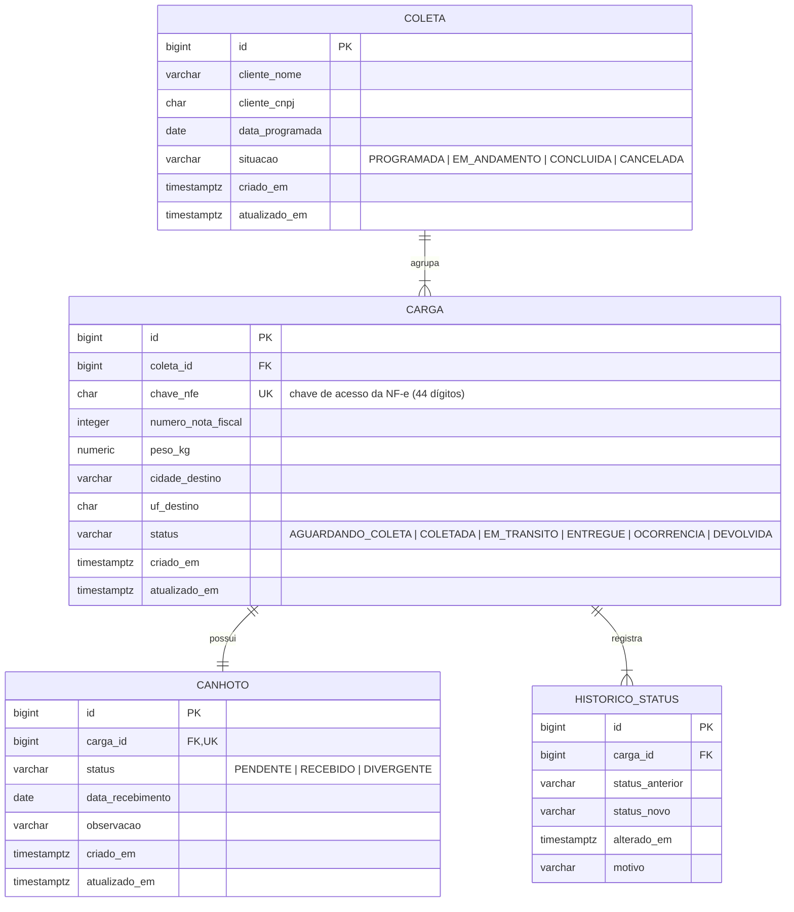

# API Controle de Canhotos

API REST para controle de coletas, cargas e devolução de canhotos (comprovantes de entrega assinados) em uma transportadora, com histórico de status por carga.

> Projeto em construção.

## Modelo de domínio



- Cada carga corresponde a **uma NF-e**, identificada pela chave de acesso.
- O canhoto nasce `PENDENTE` junto com a carga. `RECEBIDO` e `DIVERGENTE` exigem data de recebimento; `DIVERGENTE` exige observação.
- Toda mudança de status da carga gera um registro em `historico_status`.
- Evolução prevista: agrupar NFs por CT-e (uma carga com várias NFs).

## Requisitos

- Java 21+
- Docker Desktop (para subir a aplicação e rodar os testes de integração)

## Instalação

```bash
git clone https://github.com/Ejurevics/API-Controle_Canhotos.git
cd API-Controle_Canhotos
```

## Uso

_Em breve._
