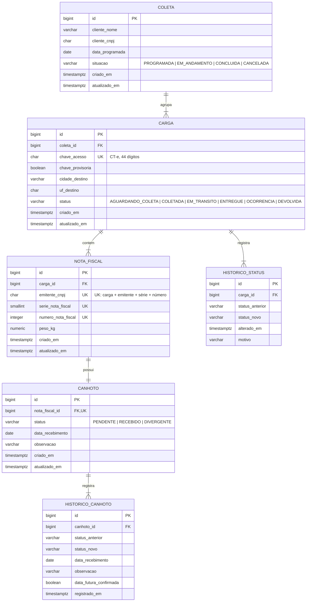

# API Controle de Canhotos

API REST para controle de coletas, cargas (CT-e) e devolução de canhotos (comprovantes de entrega assinados) em uma transportadora, com histórico de status por carga.

**Versão atual: `v0.4.0`.** O fluxo principal está pronto (coletas, cargas, canhotos e históricos), com listagens filtradas e paginadas e várias NFs agrupadas por CT-e ([ADR 0001](docs/adr/0001-agrupar-nfs-por-cte.md)), com validação da chave de acesso. Toda rota exige login (JWT, perfis ADMIN e OPERADOR, com gestão de usuários pela API; veja [Autenticação](#autenticação)).

## Modelo de domínio



- Cada carga corresponde a **um CT-e**, identificado pela chave de acesso de 44 dígitos (única no sistema e validada: modelo `57` nas posições 21 e 22 e dígito verificador em módulo 11), e agrupa **de 1 a N notas fiscais**. O status e o histórico de status são do CT-e; o peso total é a soma das NFs.
- A NF é identificada por CNPJ do emitente + série + número, **única só dentro do CT-e**: o mesmo número pode se repetir em CT-es diferentes, porque a numeração segue a de cada cliente.
- Se não informados, o CNPJ do emitente da NF assume o do cliente da coleta e a série assume `1`.
- Cada NF tem o seu canhoto, que nasce `PENDENTE` junto com ela. `RECEBIDO` e `DIVERGENTE` exigem data de recebimento; `DIVERGENTE` exige observação.
- O canhoto só pode ser registrado (`RECEBIDO` ou `DIVERGENTE`) com o CT-e (carga) `ENTREGUE`.
- Data de recebimento posterior à data atual (no fuso `America/Sao_Paulo`, independente do fuso do servidor) gera aviso e só é aceita com confirmação explícita, que fica marcada no histórico do canhoto.
- O canhoto pode ser registrado mais de uma vez (ex.: `DIVERGENTE` e depois `RECEBIDO`). Cada registro fica em `historico_canhoto` com status, data e observação; o canhoto guarda só o estado atual.
- Toda mudança de status da carga gera um registro em `historico_status`.
- Cada registro de histórico guarda o login de quem fez a mudança (`alteradoPor` na carga, `registradoPor` no canhoto), tirado do token. Os registros iniciais ficam com quem criou a coleta. Registros gravados antes da v0.5.0 ficam com o campo nulo.
- Cargas criadas antes do agrupamento por CT-e foram migradas com uma chave de acesso **provisória** (prefixo `99` + id, `chaveProvisoria: true`). Ela é corrigida com `PATCH /cargas/{id}/chave-acesso`, que aceita só chave válida e ainda não usada e só vale para chave provisória (a definitiva não muda); `GET /cargas?chaveProvisoria=true` lista as pendentes.

### Transições de status da carga

| De | Pode ir para |
|---|---|
| `AGUARDANDO_COLETA` | `COLETADA`, `OCORRENCIA` |
| `COLETADA` | `EM_TRANSITO`, `OCORRENCIA` |
| `EM_TRANSITO` | `ENTREGUE`, `OCORRENCIA`, `DEVOLVIDA` |
| `OCORRENCIA` | `AGUARDANDO_COLETA`, `COLETADA`, `EM_TRANSITO`, `ENTREGUE`, `DEVOLVIDA` |
| `ENTREGUE` | `OCORRENCIA` (retrocesso sempre passa por ocorrência) |
| `DEVOLVIDA` | — (final) |

Registrar `OCORRENCIA` exige motivo.

### Transições de situação da coleta

| De | Pode ir para |
|---|---|
| `PROGRAMADA` | `EM_ANDAMENTO`, `CANCELADA` |
| `EM_ANDAMENTO` | `CONCLUIDA`, `CANCELADA` |
| `CONCLUIDA`, `CANCELADA` | — (finais) |

Concluir a coleta exige que todas as cargas estejam `ENTREGUE` ou `DEVOLVIDA`. Caso contrário, responde `422` listando os CT-es pendentes (chave de acesso) e seus status (ex.: `35261011111111000111570010000012341000012343 (EM_TRANSITO)`). O status do canhoto não é considerado. Cancelar não tem essa exigência.

## Endpoints

| Método | Rota | Descrição |
|---|---|---|
| `POST` | `/coletas` | Cria uma coleta com seus CT-es (cargas) e as NFs de cada um (`201` + `Location`) |
| `GET` | `/coletas` | Lista coletas com filtros e paginação |
| `GET` | `/coletas/{id}` | Busca a coleta com seus CT-es e NFs |
| `PATCH` | `/coletas/{id}/situacao` | Altera a situação da coleta (`{"situacao": "..."}`) |
| `GET` | `/cargas` | Lista cargas (CT-es) com filtros e paginação |
| `GET` | `/cargas/{id}` | Busca a carga com as NFs e o histórico de status |
| `PATCH` | `/cargas/{id}/status` | Altera o status da carga (`{"status": "...", "motivo": "..."}`); `motivo` é obrigatório para `OCORRENCIA` |
| `PATCH` | `/cargas/{id}/chave-acesso` | Corrige a chave de acesso provisória de uma carga migrada (`{"chaveAcesso": "..."}`); a chave passa a ser definitiva |
| `GET` | `/canhotos` | Lista canhotos, um por NF (ex.: pendentes por cliente ou período), com paginação |
| `GET` | `/notas-fiscais/{id}/canhoto` | Busca o canhoto da NF com o histórico de registros |
| `POST` | `/notas-fiscais/{id}/canhoto/registros` | Registra o canhoto da NF como `RECEBIDO` ou `DIVERGENTE` |
| `POST` | `/auth/login` | Entra com login e senha e recebe o token JWT (rota pública) |
| `PATCH` | `/auth/senha` | O usuário logado troca a própria senha (`{"senhaAtual": "...", "novaSenha": "..."}`, `204`) |
| `POST` | `/usuarios` | Cria um usuário (`{"login", "nome", "senha", "perfil"}`, `201` + `Location`). Só ADMIN |
| `GET` | `/usuarios` | Lista usuários com filtros e paginação. Só ADMIN |
| `GET` | `/usuarios/{id}` | Busca um usuário. Só ADMIN |
| `PATCH` | `/usuarios/{id}/ativo` | Desativa ou reativa um usuário (`{"ativo": false}`). Só ADMIN |
| `PATCH` | `/usuarios/{id}/senha` | Define uma nova senha para o usuário (`{"novaSenha": "..."}`, `204`). Só ADMIN |

### Autenticação

Todas as rotas exigem um token JWT, exceto `POST /auth/login`, `/actuator/health` e a documentação (`/swagger-ui.html`, `/v3/api-docs`). Desenho e decisões no [ADR 0002](docs/adr/0002-autenticacao-jwt.md).

```bash
curl -s -X POST http://localhost:8080/auth/login \
  -H 'Content-Type: application/json' \
  -d '{"login": "admin", "senha": "<ADMIN_SENHA>"}'
# {"token":"eyJ...","tipo":"Bearer","expiraEm":"2026-10-14T21:00:00Z","perfil":"ADMIN"}

curl -s http://localhost:8080/coletas -H 'Authorization: Bearer eyJ...'
```

No Swagger, use o botão **Authorize** e cole o token.

| Perfil | Pode |
|---|---|
| `OPERADOR` | Coletas, cargas e canhotos: criar, consultar, listar, alterar status e situação, registrar canhoto. Trocar a própria senha |
| `ADMIN` | Tudo do `OPERADOR`, mais corrigir a chave de acesso provisória (`PATCH /cargas/{id}/chave-acesso`) e gerenciar usuários (`/usuarios`) |

Sem token, ou com token inválido ou expirado, a resposta é `401`; com perfil sem permissão, `403`. O token vale `JWT_EXPIRACAO` (1 hora por padrão). Login inexistente, usuário inativo e senha errada respondem igual (`401`, "Login ou senha inválidos").

#### Gestão de usuários

```bash
curl -s -X POST http://localhost:8080/usuarios \
  -H 'Authorization: Bearer eyJ...' -H 'Content-Type: application/json' \
  -d '{"login": "maria.silva", "nome": "Maria Silva", "senha": "<senha>", "perfil": "OPERADOR"}'
```

- Login: de 3 a 50 caracteres (letras, números, `.`, `-` e `_`), guardado em minúsculas e sem espaços nas pontas; repetido responde `422`.
- Senha: de 8 a 72 caracteres e no máximo 72 bytes em UTF-8 (limite do BCrypt). A resposta nunca traz a senha nem o hash.
- Usuários não são apagados, só desativados: usuário inativo não entra. Ninguém desativa o próprio usuário, e o último ADMIN ativo não pode ser desativado (`422`).
- Trocar a senha (`PATCH /auth/senha`) exige a senha atual; errada responde `422`.
- Desativar o usuário ou trocar a senha não invalida tokens já emitidos: eles valem até expirar (risco aceito no ADR 0002).

### Listagens

Todos os filtros são opcionais e combinados com `E`. Datas no formato `AAAA-MM-DD`.

| Rota | Filtros |
|---|---|
| `GET /coletas` | `situacao`, `clienteCnpj`, `dataInicio`, `dataFim` (sobre a data programada) |
| `GET /cargas` | `status`, `coletaId`, `chaveProvisoria` (`true` lista as cargas que ainda precisam de correção) |
| `GET /canhotos` | `status`, `clienteCnpj`, `dataInicio`, `dataFim` (sobre a data programada da coleta) |
| `GET /usuarios` | `perfil`, `ativo` |

Paginação: `pagina` (começa em `0`, padrão `0`) e `tamanho` (padrão `20`, máximo `100`). A ordenação é fixa: coletas pela data programada (mais recente primeiro), cargas e canhotos por `id`, usuários por `login`. A resposta traz `content` e `page` (`size`, `number`, `totalElements`, `totalPages`). Na listagem de cargas, cada item traz `quantidadeNotasFiscais` e `canhotosPendentes` em vez das NFs; use `GET /cargas/{id}` para o detalhe.

Exemplo, canhotos pendentes de um cliente em novembro:

```
GET /canhotos?status=PENDENTE&clienteCnpj=11111111000111&dataInicio=2026-11-01&dataFim=2026-11-30
```

Filtro com valor inválido (`situacao=XYZ`, data malformada) responde `400`; período invertido e `pagina`/`tamanho` fora do limite respondem `422`.

Registro do canhoto de uma NF (`observacao` obrigatória na `DIVERGENTE`; `dataFuturaConfirmada` opcional, padrão `false`):

```json
{ "status": "RECEBIDO", "dataRecebimento": "2026-10-14", "dataFuturaConfirmada": false }
```

Se a data for posterior a hoje (fuso `America/Sao_Paulo`), a primeira tentativa responde `409` com `confirmacaoNecessaria: true`. O cliente avisa o usuário e reenvia com `dataFuturaConfirmada: true`.

Exemplo de `POST /coletas` com um CT-e de duas NFs (`emitenteCnpj` e `serieNotaFiscal` são opcionais em cada NF):

```json
{
  "clienteNome": "Cliente A",
  "clienteCnpj": "11111111000111",
  "dataProgramada": "2026-10-20",
  "cargas": [
    {
      "chaveAcesso": "35261011111111000111570010000012341000012343",
      "cidadeDestino": "Campinas",
      "ufDestino": "SP",
      "notasFiscais": [
        { "numeroNotaFiscal": 1001, "pesoKg": 150.5 },
        { "numeroNotaFiscal": 1002, "pesoKg": 49.5 }
      ]
    }
  ]
}
```

Erros seguem o formato `ProblemDetail` (RFC 9457):

| Status | Quando |
|---|---|
| `400` | Dados inválidos (campo a campo em `erros`) |
| `401` | Sem token, token inválido ou expirado, ou login com credenciais inválidas |
| `403` | Perfil sem permissão para a operação |
| `404` | Recurso não encontrado |
| `409` | Confirmação necessária (`confirmacaoNecessaria: true`) ou violação de integridade |
| `422` | Regra de negócio violada (ex.: CT-e já cadastrado, NF repetida no mesmo CT-e) |

## Stack

Java 21 · Spring Boot 4.1 · Spring Data JPA (Hibernate 7) · PostgreSQL 18 · Flyway · springdoc-openapi · JUnit 5 + Testcontainers

## Requisitos

- [Docker Desktop](https://www.docker.com/products/docker-desktop/) — para subir a aplicação e rodar os testes de integração
- Java 21+ — só para rodar fora do Docker ou executar os testes (o Maven vem pelo wrapper `mvnw`)

## Instalação e uso

### Tudo no Docker

```bash
git clone https://github.com/Ejurevics/API-Controle_Canhotos.git
cd API-Controle_Canhotos
cp .env.example .env          # preencha JWT_SECRET e ADMIN_SENHA (veja Configuração)
docker compose up --build
```

Sem `JWT_SECRET` e `ADMIN_SENHA` no `.env`, o `docker compose` não sobe e avisa qual variável falta. Na primeira subida é criado o ADMIN `ADMIN_LOGIN` (padrão `admin`) com a senha `ADMIN_SENHA`; veja [Autenticação](#autenticação).

| O quê | URL |
|---|---|
| Swagger UI | http://localhost:8080/swagger-ui.html |
| OpenAPI (JSON) | http://localhost:8080/v3/api-docs |
| Health check | http://localhost:8080/actuator/health |

As tabelas são criadas automaticamente pelo Flyway na subida. Para parar: `docker compose down` (adicione `-v` para apagar também os dados do banco).

### Desenvolvimento local

Sobe só o banco no Docker e roda a aplicação na máquina (perfil `dev`, com SQL no log e valores de desenvolvimento para o JWT e o ADMIN inicial: login `admin`, senha `admin12345`):

```bash
docker compose up -d db
./mvnw spring-boot:run        # Windows: .\mvnw.cmd spring-boot:run
```

### Testes

Com o Docker rodando:

```bash
./mvnw test                   # Windows: .\mvnw.cmd test
```

Os testes de integração sobem um PostgreSQL descartável via Testcontainers.

O GitHub Actions (`.github/workflows/ci.yml`) roda `./mvnw clean verify` em todo PR e push para `develop` e `main`.

## Configuração

Copie `.env.example` para `.env` e preencha. O `docker compose` lê o `.env` automaticamente. `JWT_SECRET` e `ADMIN_SENHA` são obrigatórias no compose; as demais têm valor padrão.

| Variável | Padrão | Uso |
|---|---|---|
| `DB_NAME` | `canhotos` | Nome do banco |
| `DB_USERNAME` | `canhotos` | Usuário do banco |
| `DB_PASSWORD` | `canhotos` | Senha do banco |
| `DB_PORT` | `5432` | Porta do PostgreSQL exposta na máquina |
| `APP_PORT` | `8080` | Porta da API exposta na máquina |
| `JWT_SECRET` | — (obrigatória) | Segredo de assinatura do JWT, com pelo menos 32 caracteres. Gere um com `openssl rand -base64 48` |
| `JWT_EXPIRACAO` | `PT1H` | Validade do token, em ISO-8601 (`PT1H` = 1 hora) |
| `ADMIN_LOGIN` | `admin` | Login do primeiro ADMIN, criado na subida se ainda não houver nenhum |
| `ADMIN_NOME` | `Administrador` | Nome do primeiro ADMIN |
| `ADMIN_SENHA` | — (obrigatória) | Senha do primeiro ADMIN, com pelo menos 8 caracteres. Ignorada depois que o ADMIN existe |

Perfis Spring:

- `dev` (padrão): aplicação local apontando para `localhost:5432`, com log de SQL e valores de desenvolvimento para `JWT_SECRET` e `ADMIN_SENHA` (`admin12345`). Só para a máquina local e os testes.
- `docker`: usado pelo compose; exige `DB_URL`, `DB_USERNAME`, `DB_PASSWORD` e `JWT_SECRET` (sem valor padrão, falha rápido se faltar).

## Estrutura

```
src/main/java/br/com/controlecanhotos/
├── coleta/        Coleta, situação, service, controller e DTOs
├── carga/         Carga (CT-e), status, regras de transição e DTOs
├── notafiscal/    Nota fiscal (de 1 a N por CT-e) e DTOs
├── canhoto/       Canhoto (um por NF), status, service, controllers e DTOs
├── historico/     Histórico de status da carga e de registros do canhoto
├── usuario/       Usuário, perfil (ADMIN, OPERADOR) e gestão de usuários
├── seguranca/     Login, emissão e validação do JWT, regras de acesso e ADMIN inicial
└── shared/        Exceções, tratamento global de erros (ApiExceptionHandler) e paginação
src/main/resources/
├── application.yml
└── db/migration/  Migrations Flyway (V1__, V2__...)
.github/workflows/ci.yml  CI: build e testes a cada PR
Dockerfile         Build multi-stage (JDK para compilar, JRE para rodar)
docker-compose.yml App + PostgreSQL com healthcheck
docs/adr/          Decisões de arquitetura (ADRs)
```

## Fluxo de desenvolvimento

- `main`: versões estáveis, marcadas com tag (`v0.4.0`). Só recebe a `develop` via PR de release, com merge commit.
- `develop`: integração. Recebe os PRs de feature, com squash.
- Branches de trabalho nascem da `develop` (`feat/`, `fix/`, `chore/`, `docs/`, `refactor/`) e são apagadas após o merge.
- Commits seguem Conventional Commits (`feat(coleta): adiciona ...`).
- Todo PR roda o CI (`./mvnw -B clean verify`). Mudanças que alteram uso, setup ou estrutura atualizam este README no mesmo PR.

## Roadmap

- [x] Listagens com filtros e paginação (coletas por situação, cliente e período; cargas por status; canhotos pendentes).
- [x] Testes de service.
- [x] Regra para concluir uma coleta com base no status das cargas.
- [x] Autenticação com JWT e perfis ADMIN e OPERADOR ([ADR 0002](docs/adr/0002-autenticacao-jwt.md)).
- [x] Gestão de usuários pela API (criar, listar, desativar, trocar senha).
- [x] Histórico da carga e do canhoto registra o usuário que fez cada mudança.
- [x] Agrupar NFs por CT-e (uma carga com várias NFs). Desenho em [ADR 0001](docs/adr/0001-agrupar-nfs-por-cte.md).
