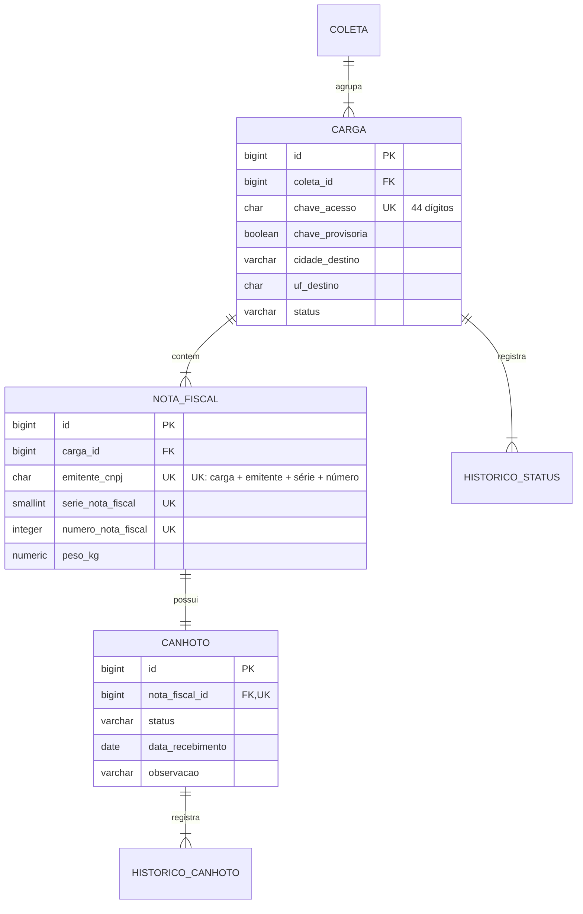

# ADR 0001: Agrupar NFs por CT-e

- **Status:** aceita (implementada; sai na `v0.3.0`)
- **Data:** 2026-10-14

## Contexto

Hoje cada `Carga` corresponde a **uma** NF, identificada por emitente + série + número, e essa combinação é única no sistema inteiro. Na operação real:

- um CT-e (conhecimento de transporte) agrupa **várias NFs**;
- CT-es diferentes podem ter NFs com o **mesmo número**, porque o número da NF segue a numeração de cada cliente (o número do pedido, por exemplo).

O modelo atual não representa o primeiro ponto e a unicidade global contradiz o segundo.

## Decisão

1. **A `Carga` passa a ser o CT-e.** Mantém o nome, o status e o histórico de status. Ganha a **chave de acesso de 44 dígitos**, única no sistema.
2. **Nova entidade `NotaFiscal`**, filha da carga (uma carga tem de 1 a N notas). Guarda emitente, série, número e peso.
3. **Unicidade da NF só dentro do CT-e:** `(carga_id, emitente_cnpj, serie, numero)`. O mesmo emitente + série + número pode aparecer em CT-es diferentes.
4. **O canhoto passa a ser por NF** (1:1 com `NotaFiscal`), com seu próprio histórico de registros. Só pode ser registrado com a **carga** (CT-e) `ENTREGUE`.
5. **Cidade e UF de destino ficam no CT-e** (um CT-e tem um destino). O **peso fica na NF**; o peso total do CT-e é a soma das NFs.
6. **A regra de conclusão da coleta não muda:** exige as cargas `ENTREGUE` ou `DEVOLVIDA`, sem olhar canhoto.

### API (mudança incompatível)

| Hoje | Depois |
|---|---|
| `POST /coletas` com `cargas[]` de uma NF cada | `cargas[]` com `chaveAcesso`, `cidadeDestino`, `ufDestino` e `notasFiscais[]` (emitente e série opcionais, com os mesmos padrões de hoje) |
| `GET /cargas/{id}` | inclui `notasFiscais[]`, cada uma com o status do seu canhoto, e o peso total |
| `GET` e `POST /cargas/{id}/canhoto...` | `GET` e `POST /notas-fiscais/{id}/canhoto...` |
| `GET /canhotos` | uma linha por NF, com `chaveAcesso` do CT-e; mesmos filtros |
| `GET /cargas` | passa a trazer a quantidade de NFs e de canhotos pendentes |

Por ser mudança incompatível em `0.x`, vai na versão `v0.3.0`, com `!` no tipo do commit e `BREAKING CHANGE:` no rodapé.

### Migração dos dados existentes

Migration Flyway nova (nunca altera as já mergeadas):

1. Cria `nota_fiscal` e copia, para cada carga atual, uma NF com emitente, série, número e peso.
2. Move o canhoto: `canhoto.carga_id` vira `canhoto.nota_fiscal_id`, apontando para a NF criada no passo 1.
3. As cargas atuais **não têm chave de acesso**. Cada uma recebe uma chave provisória de 44 dígitos (prefixo `99` + id preenchido com zeros) com `chave_provisoria = true`, para ser corrigida depois. A coluna `peso_kg` sai de `carga`.
4. Remove a unicidade global antiga da NF e cria a unicidade por CT-e.

## Consequências

- **Positivas:** representa o CT-e com várias NFs; o canhoto aponta a NF exata que voltou com divergência; números de NF repetidos entre CT-es deixam de dar erro.
- **Negativas:** a API quebra (rotas e corpos mudam); deixamos de barrar a mesma NF cadastrada em dois CT-es, o que antes era erro; as cargas já cadastradas ficam com chave provisória.
- **Risco aceito:** a falta de unicidade global da NF permite duplicidade por engano entre CT-es. A chave de acesso única do CT-e é a única proteção contra cadastrar o mesmo CT-e duas vezes.

## Alternativas descartadas

- **Unicidade global da NF (como hoje):** contradiz a numeração repetida entre clientes.
- **Sem unicidade da NF:** aceitaria a mesma NF duas vezes no mesmo CT-e.
- **Identificar o CT-e por número + série + CNPJ da transportadora:** exigiria guardar a transportadora e não tem a unicidade nacional da chave.
- **Canhoto por CT-e:** não diz qual NF voltou com divergência.
- **Status por NF, com o CT-e só como agrupador:** mais flexível, porém com muito mais regras de transição e sem necessidade hoje.
- **Recomeçar do zero em vez de migrar:** perderia os históricos já registrados.

## Plano de entrega

1. Este ADR, em PR só de documentação.
2. Implementação (migration, domínio, services, controllers, testes e README) em um PR único, porque o modelo não compila pela metade. Depois, release `v0.3.0`.

## Notas da implementação

- **Contagens na listagem de cargas:** `quantidadeNotasFiscais` e `canhotosPendentes` são calculadas pelo banco (`@Formula`) junto com a consulta paginada. Carregar as NFs de cada carga da página geraria uma consulta por linha; um `join fetch` de coleção quebraria a paginação no banco.
- **Rota antiga do canhoto removida:** `/cargas/{id}/canhoto` passa a responder `404`; use `/notas-fiscais/{id}/canhoto`.
- **Migration validada com dados:** `MigracaoNotasFiscaisTest` aplica a V3 sobre dados criados no esquema da V2 e confere NFs, canhotos, históricos, chaves provisórias e as novas unicidades.
